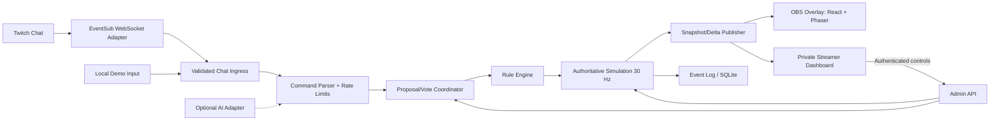
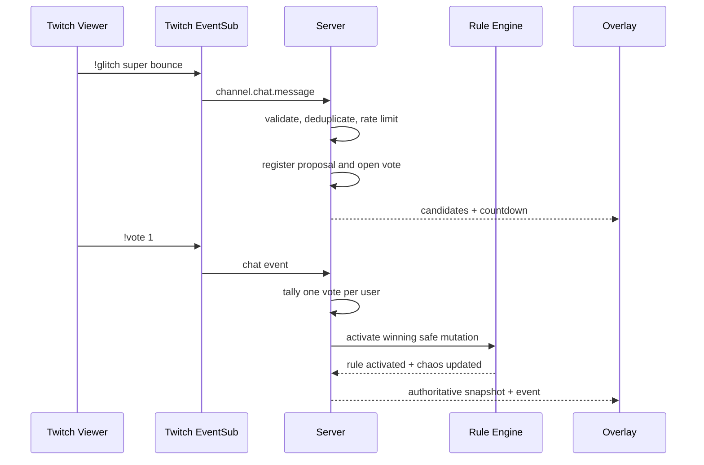

# Reality Glitch — Technical Design

Version 1.0 · 2026-11-02 · Status: Proposed

## 1. Design principles
Requirements-first; local-first; deterministic authoritative state; explicit trust boundaries; event-driven adapters; no mandatory paid services; typed allowlisted effects; fail-safe behavior; small deployable footprint; testability and observability. Architecture is a modular monolith, not microservices.

## 2. Stack and costs
| Concern | Choice | Reason / cost |
|---|---|---|
| Language | TypeScript strict mode | Shared types, free |
| Frontend | React + Vite | Lightweight, free |
| Game | Phaser 3 + Matter.js | 2D physics, free/open source |
| Backend | Node.js LTS + Fastify | Small local server, free |
| Transport | `ws` WebSocket | Local state streaming, free |
| Validation | Zod | Runtime schema checking, free |
| Persistence | SQLite + `better-sqlite3` | Local settings/replay metadata, free |
| Twitch | OAuth Authorization Code + PKCE; EventSub WebSocket | No public webhook required |
| Testing | Vitest, fast-check, Playwright | Unit/property/E2E, free |
| Streaming | OBS browser source | Free |
| Optional AI | Provider adapter, disabled by default | Usage-based if enabled |
| Automation | GitHub Actions free allowance / local scripts | Avoid mandatory cloud dependency |

Use current maintained compatible versions pinned in lockfile, with license/security review before release. The optional AI adapter must not be on the game-loop critical path.

## 3. Architecture


**Authority model:** Backend owns session, votes, rules, tick progression, objective evaluation, and canonical entity state. Phaser client renders snapshots/interpolates; it must never decide victory, voting results, or active modifiers. To avoid duplicating physics engines, the backend uses Matter.js headlessly for the canonical world, while Phaser uses its renderer only; do not instantiate a second active client-side physics world. Fixed 30 Hz stepping uses an accumulator with capped catch-up steps, monotonic server time, and integer tick-based effect expiry. Physics determinism is only guaranteed for identical runtime/build/seed and normalized event order; CI replay uses a pinned runtime/container.

## 4. Repository layout
```
reality-glitch/
  .kiro/specs/reality-glitch/{requirements.md,design.md,tasks.md}
  apps/web/src/{dashboard,overlay,game,components}
  apps/server/src/{api,auth,twitch,simulation,transport,storage}
  packages/domain/src/{commands,rules,voting,missions,events,schemas}
  packages/config/
  tests/{integration,e2e,fixtures,replay}
  scripts/{demo,healthcheck}
  .env.example
  README.md
```
Use npm workspaces. Domain package has no dependency on Twitch, HTTP, React, or databases.

## 5. Core data contracts
```ts
type MutationId =
  | 'gravity-up' | 'gravity-left' | 'gravity-right' | 'moon-gravity'
  | 'super-bounce' | 'slippery-floor' | 'sticky-floor'
  | 'speed-boost' | 'slow-motion' | 'moving-platforms'
  | 'walking-trees' | 'magnetic-crystal';
type Phase = 'idle' | 'propose' | 'vote' | 'cooldown' | 'complete';
interface ChatEvent {
  source: 'twitch' | 'demo'; messageId: string; channelId: string;
  userId: string; text: string; receivedAtMs: number;
}
interface MutationDefinition {
  id: MutationId; durationTicks: number; chaosWeight: number;
  category: string; conflicts: MutationId[]; maxStack: number;
  apply: (ctx: RuleContext) => RuleContribution;
}
interface ActiveRule { id: MutationId; activatedTick: number; expiresTick: number; }
interface VoteRound {
  id: string; phase: Phase; phaseEndTick: number;
  candidates: MutationId[]; votesByUser: Record<string, MutationId>;
}
interface WorldSnapshot {
  sessionId: string; tick: number; seed: number; missionId: string;
  chaos: number; phase: Phase; entities: EntityState[];
  activeRules: ActiveRule[]; stateHash: string;
}
```
`RuleContribution` is a data-only tagged union (gravity vector, restitution multiplier, friction multiplier, speed multiplier, timescale, bounded force, entity animation, platform path). No functions or code cross the network. Define schemas for every incoming and outgoing contract using Zod. Keep all coordinates and forces within centrally configured bounds.

## 6. Mutation composition and physics
1. Build baseline world parameters from the mission configuration at each tick.
2. Filter expired effects by tick; sort remaining rules by category precedence then stable ID.
3. Reject conflicting gravity directions and mutually exclusive floor friction rules at activation time.
4. Apply additive vector contributions with clamping; multiply bounded scalar modifiers in stable order; resolve categorical flags by precedence.
5. Apply effective parameters to the Matter.js world, then advance one fixed tick.
6. Evaluate mission invariants and victory conditions; publish state and domain events.

Avoid mutating baseline physics values irreversibly. If a rule expires, recompute from baseline and remaining rules. Set hard caps on gravity magnitude, velocity, entity count, restitution, force, and spatial bounds. Slow motion changes the world step multiplier through a bounded deterministic policy, not wall-clock timers. Predefined tree motion and moving platforms are deterministic scripted entities. Four named combos are detected from active-rule sets and trigger cosmetic announcements; any additional physical effect must be separately specified and bounded.

## 7. Vote coordinator
- Proposal phase 15s, vote phase 10s, cooldown 5s, measured in simulation ticks; configurable.
- Parse normalized lowercased aliases; no regex with catastrophic backtracking. Reject unknown commands.
- One proposal/user/round; candidate shortlist contains at most three distinct eligible modifiers ranked by unique proposers then seeded tie-break.
- One mutable vote/user/round; at close, winner chosen by count then seeded tie-break.
- Check conflicts and safety before activation. If winning candidate is invalid, try next ranked candidate; if none qualifies, record a no-op round.
- Per-user token bucket (default 3 commands/10s) and global bucket (default 20/s). Queue max 1,000; discard excess viewer events and retain control events separately.
- Deduplicate Twitch message IDs using a bounded TTL cache; never use display names as voter identity.

## 8. Twitch integration and OAuth
Implement a locally bound backend OAuth Authorization Code flow with PKCE, state validation, exact redirect URI allowlist, and secure HttpOnly SameSite cookies for operator sessions. Store Twitch client ID in config; never expose client secret or access/refresh tokens to frontend. Use a user access token with `user:read:chat` for an installed broadcaster-connected chat reader, with exact scopes verified against current Twitch documentation. Subscribe to EventSub `channel.chat.message` version 1 with broadcaster and chatting user IDs. EventSub WebSocket subscription creation requires a user access token. Respect `session_welcome`, `session_reconnect`, keepalive, revocation, and duplicate-delivery handling. Validate session and subscription identities, message sizes, and payload shape. Reconnect with jittered exponential backoff and resubscribe when required; follow Twitch's reconnect URL rather than blindly creating a second session. On token expiry, refresh securely if possible, otherwise request authorization again. The MVP does not post to chat or need public webhooks.

**Important:** local development OAuth redirect must match the registered Twitch developer application configuration. Keep `/auth/*` off the OBS overlay and avoid passing credentials in browser-source URLs.

## 9. Network contracts
- `GET /healthz` → process health (no secrets).
- `GET /api/session` → current public session metadata.
- `POST /api/admin/session/start|pause|resume|reset|end` → protected actions.
- `POST /api/admin/mission/select` → protected validated mission selection.
- `POST /api/admin/stabilize` → protected emergency reset of transient effects.
- `POST /api/admin/demo/event` → protected simulated chat injection, only when demo mode enabled.
- `GET /auth/twitch/start`, `GET /auth/twitch/callback` → OAuth.
- `GET /ws` → WebSocket with `snapshot`, `delta`, `phase`, `mutation`, `combo`, `collapse`, `health` messages.

Bind HTTP/WebSocket listener to `127.0.0.1` by default. Authenticate admin calls using an unpredictable local operator session established by a one-time startup secret; validate Origin and use CSRF protection for cookie-authenticated mutations. Public overlay WebSocket is read-only and contains only redacted public state. If remote access is later required, introduce TLS and explicit access control rather than exposing local endpoints.

### Event lifecycle


## 10. Chaos controller
Each mutation has a weight (5–20). Chaos is clamped 0–100 and decays by a configurable amount per simulation second. On threshold and outside cooldown, activate a scripted 8-second Collapse: camera shake, safe gravity cycling, color grading, and particle burst. Effects are allowlisted, bounded, and disabled/reduced in reduced-motion mode. Afterward clear collapse-specific rules, set chaos to 25, and start a 45-second cooldown. Emergency Stabilize cancels collapse, clears temporary rules, resets entity velocities within bounds, and places the player at a safe checkpoint if necessary.

## 11. Persistence and privacy
SQLite tables: `settings`, `sessions`, `domain_events`, `replay_metadata`, `oauth_tokens` (optional encrypted), `blocked_users`. Use WAL mode and prepared statements; migrate with versioned migrations. Store pseudonymous Twitch IDs only as necessary for active session moderation/voting; no raw chat retention by default. Persist sanitized domain events (accepted command type, mutation ID, tick, seed, state hash) for replay. Provide delete-session-data action. If tokens are persisted, encrypt with an operator-supplied secret kept outside the DB; otherwise prefer ephemeral tokens for MVP.

## 12. Failure modes
| Failure | Behavior |
|---|---|
| Twitch unavailable | Continue game; show offline; demo input remains usable |
| Invalid/hostile chat | Drop safely, increment metrics, do not echo untrusted content |
| EventSub duplicate | Deduplicate by message ID |
| Optional AI timeout | Deterministic parser fallback, no physics blocking |
| Overlay disconnect | Reconnect and request fresh snapshot; discard stale deltas |
| Simulation invariant failure | Freeze new mutations, log error, offer safe reset |
| Excess chat volume | Bound queues, rate-limit, shed noncritical inputs |
| Mission softlock | Checkpoint respawn or Emergency Stabilize |
| Token revoked | Stop Twitch ingestion and require reauthorization |

## 13. Testing and quality strategy
- **Unit:** parser aliases, invalid payloads, vote replacement, deterministic tie-break, rule compatibility, expiration, chaos caps, admin auth.
- **Property-based:** mutation composition always respects bounds; rule expiration restores baseline; duplicate chat does not double-vote; arbitrary text never becomes executable instructions.
- **Integration:** Twitch adapter with recorded fixture payloads; reconnect/revocation; WebSocket snapshot/delta synchronization; SQLite migrations.
- **Replay:** fixed seed and ordered events produce identical state hashes under pinned runtime; compare at checkpoints.
- **E2E:** Playwright streamer dashboard, demo commands, OBS-sized overlay, pause/reset, reduced-motion, reconnect.
- **Load:** synthetic 20 messages/s for 5 minutes; assert bounded memory/queue and command-to-ack p95.
- **Security:** dependency audit, secret scan, invalid-origin/CSRF tests, no tokens in overlay payload or logs.
- **Manual:** live Twitch account test; three-minute recorded demo; fresh-install checklist.

CI pipeline: format → lint → typecheck → unit/property → integration → build → Playwright smoke → dependency/security checks. Enforce ≥80% domain/parser line coverage; keep flaky timing assertions out of deterministic tests.

## 14. Deployment and operation
Default `npm install`, `npm run dev` starts backend and Vite frontend locally. `npm run demo` starts without Twitch credentials and injects scripted commands. `npm run test`, `npm run test:e2e`, `npm run build`, and `npm run replay:verify` are documented. OBS browser source points to local `/overlay`, with transparent background and 1920×1080 dimensions. Provide `.env.example` containing only placeholders (`TWITCH_CLIENT_ID`, `TWITCH_REDIRECT_URI`, optional AI configuration), never committed secrets. Document local Twitch application registration, OAuth setup, troubleshooting, and how to revoke authorization.

## 15. Requirement traceability
| Requirement | Design sections | Primary verification |
|---|---|---|
| R01 | 3, 5, 9 | Mission and admin E2E |
| R02 | 8, 12 | Twitch fixture and live test |
| R03 | 7 | Vote/parser unit and property tests |
| R04 | 5, 6 | Rule composition and safety properties |
| R05 | 10 | Chaos/collapse unit and E2E |
| R06 | 3, 9, 14 | OBS-size visual E2E |
| R07 | 3, 11, 14 | Offline demo and replay |
| R08 | 8, 9, 11, 12 | Security and failure tests |
| R09 | 2, 12 | Optional adapter contract tests |
| N01–N10 | 2, 3, 6, 8, 13, 14 | CI, load, accessibility and manual gates |

## 16. Architectural decisions and deferred work
- **ADR-001:** Modular monolith instead of microservices: lowest operational cost and complexity.
- **ADR-002:** Backend-owned Matter.js simulation, Phaser rendering: consistent authority and replayability.
- **ADR-003:** EventSub WebSocket instead of webhook: local-first without public hosting.
- **ADR-004:** Deterministic allowlist instead of arbitrary AI-generated code: safe and free baseline.
- **ADR-005:** SQLite instead of managed database: zero recurring cost for single-channel MVP.
- **ADR-006:** Fixed tick simulation and domain event log: reproducible demos and regression tests.

Future enhancements may include controlled LLM interpretation, additional worlds, channel-point integrations, streamer-versus-streamer events, and hosted deployments. Each requires a separate spec and security review.

## 17. Implementation sequencing guidance
Generate `tasks.md` after approving these two documents. Recommended checkpoints: (1) repo/tooling and shared schemas; (2) deterministic simulation, missions, rule engine and tests; (3) local demo, voting and overlay; (4) Twitch OAuth/EventSub and resilience; (5) OBS demo hardening, accessibility, security and replay validation. Do not start optional AI work before all P0 gates pass.
